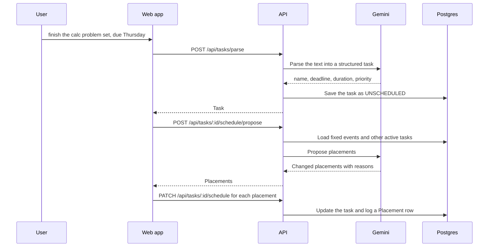
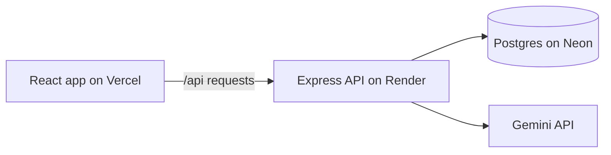

# Smart Weekly Planner

A weekly planner that schedules your tasks for you. You type or say what you need to do ("finish the calc problem set, due Thursday"), and the app finds a slot in the open time around your classes and other fixed commitments. When a new task is more urgent than something already scheduled, it moves the less urgent one, and it gives a reason for every placement. You can drag any task to a different time yourself.

Live demo: https://smart-planner-api.vercel.app

The backend runs on Render's free tier and sleeps after 15 minutes without traffic, so the first request after a quiet period can take 30 to 60 seconds. The demo has no accounts yet, which means every visitor sees the same data. Please don't enter anything personal.

## Contents

- [Overview](#overview)
- [How it works](#how-it-works)
- [Features](#features)
- [Tech stack](#tech-stack)
- [Architecture](#architecture)
- [Getting started](#getting-started)
- [Deployment](#deployment)
- [Known limitations](#known-limitations)
- [Roadmap](#roadmap)
- [Author](#author)

## Overview

Most planners make you do the scheduling: you pick a time, drag a block, and rearrange everything by hand when something urgent shows up. This project hands that work to an LLM and keeps the result reviewable. The model decides where a task goes, and the app stores and shows its reasoning so you can accept it, or override it with a drag.

It is a full-stack TypeScript project built as a portfolio piece. Two LLM calls do the interesting work, one that turns free text into a structured task and one that decides where tasks go. Everything around them is ordinary application code: a React calendar, an Express API, a Postgres database, and schema validation shared between the frontend and backend.

## How it works

1. You enter your fixed weekly schedule once (classes, work, anything that repeats every week).
2. You add a task by typing or speaking it.
3. The API sends the text to Gemini, which returns a name, deadline, estimated duration, and priority. The API validates that result and saves the task as unscheduled.
4. A second Gemini call receives your fixed events, your other active tasks, and the new task. It returns only the placements that are new or have to change, each with a one-sentence reason.
5. The web app applies those placements. The calendar updates, and the sidebar shows the reasons.
6. Dragging a task to another time saves the move with the reason "Moved manually by the user."



## Features

- Weekly calendar (6am to midnight) with fixed events and tasks, built on FullCalendar.
- Fixed events that repeat every week, entered by day and time range.
- Task entry by typing, or by voice using the browser's Web Speech API. Voice input fills the text box and does not submit on its own, so you can fix a misheard word before the task is parsed.
- LLM task parsing, including relative dates like "Thursday" or "tomorrow."
- LLM scheduling that avoids fixed events, respects deadlines, and keeps work inside an 8am to 11pm window. When time is tight, higher priority and earlier deadlines win. Tasks without a deadline fill whatever time is left.
- A reason for every placement, and a marker on tasks that were just rescheduled.
- Drag and resize to override any scheduled task.
- A list of tasks that are not scheduled yet, with a button to schedule each one.
- Dark theme, and PWA setup (service worker and web manifest) through `vite-plugin-pwa`.

## Tech stack

| Area | Choice |
| --- | --- |
| Frontend | React 18, TypeScript, Vite, FullCalendar 6, TanStack Query 5, date-fns |
| Backend | Node.js, Express 4, TypeScript |
| Database | PostgreSQL on Neon, accessed through Prisma 5 |
| AI | Google Gemini through `@google/genai` (default model `gemini-3.6-flash`) |
| Validation | zod, in a package shared by both apps |
| Voice input | Web Speech API (browser built in, no backend involved) |
| Hosting | Vercel (frontend), Render (backend), Neon (database) |

## Architecture



### Repository layout

This is an npm workspaces monorepo.

```
apps/
  web/                 React + Vite frontend
    src/components/    Calendar, task form, unscheduled list, activity log
    src/hooks.ts       TanStack Query hooks for every API call
    src/api.ts         Fetch wrapper for the backend
  api/                 Express backend
    prisma/            Schema and migrations
    src/routes/        tasks, fixedEvents, schedule
    src/llm/           Provider interface, Gemini implementation, retry, errors
    src/time.ts        Timezone handling for LLM calls
packages/
  shared/              zod schemas and types used by both apps
```

### Data model

| Model | Purpose | Main fields |
| --- | --- | --- |
| `FixedEvent` | A commitment that repeats weekly | `title`, `dayOfWeek` (0 is Sunday), `startTime`, `endTime` as `HH:MM` |
| `Task` | Something to schedule | `name`, `deadline` (optional), `durationMin`, `priority` (`LOW`, `MEDIUM`, `HIGH`), `status` (`UNSCHEDULED`, `SCHEDULED`, `COMPLETED`), `scheduledStart`, `scheduledEnd` |
| `Placement` | One entry per time a task was placed or moved | `taskId`, `start`, `end`, `reason` |

Deleting a task deletes its placements.

### API

All routes live under `/api`.

| Method and path | What it does |
| --- | --- |
| `GET /health` | Health check |
| `GET /fixed-events` | List fixed events |
| `POST /fixed-events` | Create a fixed event |
| `DELETE /fixed-events/:id` | Delete a fixed event |
| `GET /tasks` | List tasks, ordered by deadline |
| `POST /tasks` | Create a task from structured fields |
| `POST /tasks/parse` | Parse free text with Gemini and save the result as a task |
| `DELETE /tasks/:id` | Delete a task |
| `POST /tasks/:id/schedule/propose` | Ask Gemini where the task should go. Reads from the database and changes nothing |
| `PATCH /tasks/:id/schedule` | Apply a placement, from the AI or from a drag, and log it |
| `GET /tasks/:id/placements` | Placement history for a task, newest first |

### Design decisions

#### One interface for all model calls

Routes never import a Gemini SDK directly. They call an `LLMProvider` interface (`apps/api/src/llm/types.ts`) with two methods, `parseTask` and `proposeSchedule`. `GeminiProvider` is the only implementation today. Adding another provider means writing one class and adding a case to `getLLMProvider` in `apps/api/src/llm/index.ts`.

#### Structured output, validated again on the server

Both Gemini calls use a `responseSchema` so the model has to return JSON in a fixed shape. The API still parses that JSON with the shared zod schema before using it, because a schema-constrained response is model output and can still be wrong.

#### Only changed placements come back

The scheduling prompt asks for the new task plus any task that has to move, and nothing else. A full replan on every request would shuffle unrelated tasks and make the explanations meaningless.

#### Reasons are stored, not regenerated

Each placement, whether it came from the model or from a drag, is saved as a `Placement` row with its reason. The sidebar shows the reasons from the most recent scheduling run, and the full history is available from the API.

#### Time is always given in local time

Early on, the scheduling call received the current time as UTC, so "8am" was being read as 8am UTC. Every LLM call now gets the current time in the app's timezone with an explicit offset, from `formatLocal` in `apps/api/src/time.ts`. The timezone is the server's own by default and can be set with `APP_TIMEZONE`.

#### Retries for model overload

Gemini sometimes answers with a 503 when the model is busy. The API retries those calls up to three times with a growing delay (`apps/api/src/llm/retry.ts`) and does not retry other errors. A retried call can take about a minute. If it still fails, the task stays in the unscheduled list and can be scheduled again with one click.

#### Tasks without a deadline are allowed

A task with no deadline is treated as flexible and lower urgency. It fills open time but never displaces a task that has a deadline.

## Getting started

### Prerequisites

- Node.js (developed and deployed on Node 24)
- A PostgreSQL database. A free [Neon](https://neon.tech) project works. The repo's `docker-compose.yml` starts a local Postgres 16 if you would rather run it yourself.
- A Gemini API key from [Google AI Studio](https://aistudio.google.com/apikey)

### Setup

```bash
git clone https://github.com/pranavSinthoju/smart-planner.git
cd smart-planner
npm install
cp apps/api/.env.example apps/api/.env
```

`npm install` also builds `packages/shared` and generates the Prisma client. Fill in `apps/api/.env`, then apply the database migrations and start both apps:

```bash
npm run prisma:migrate -w apps/api
npm run dev
```

The web app is at http://localhost:5173 and the API is at http://localhost:4000. In development, Vite forwards `/api` requests to the API, so the frontend needs no configuration.

### Environment variables

Backend, in `apps/api/.env`:

| Variable | Required | Description |
| --- | --- | --- |
| `DATABASE_URL` | Yes | Connection string the app uses at runtime. With Neon, use the pooled string |
| `DIRECT_URL` | Yes | Unpooled connection string, used by Prisma for migrations. With a local Postgres, use the same value as `DATABASE_URL` |
| `GEMINI_API_KEY` | Yes | Google AI Studio key |
| `GEMINI_MODEL` | No | Model name. Defaults to `gemini-3.6-flash` |
| `LLM_PROVIDER` | No | Defaults to `gemini`, the only provider implemented |
| `PORT` | No | Defaults to `4000` |
| `APP_TIMEZONE` | No | IANA timezone name such as `America/New_York`. Defaults to the server's timezone |

Frontend, in `apps/web/.env`:

| Variable | Required | Description |
| --- | --- | --- |
| `VITE_API_URL` | Production only | Origin of the deployed API. Leave it unset locally |

### Scripts

| Command | What it does |
| --- | --- |
| `npm run dev` | Runs the web app and API together with hot reload |
| `npm run build` | Builds `packages/shared`, then the API, then the web app |
| `npm run prisma:migrate -w apps/api` | Applies migrations in development |
| `npm run start -w apps/api` | Applies pending migrations, then starts the built API |

## Deployment

The live site uses three services.

Frontend on Vercel: import the repository, set the root directory to `apps/web`, and use the Vite preset. Set `VITE_API_URL` to the backend's origin with no trailing slash. Vercel serves static files only, so the frontend can't reach the API without this variable.

Backend on Render: create a web service from the repository and leave the root directory blank, because npm workspaces need to install from the repo root.

| Setting | Value |
| --- | --- |
| Build command | `npm install && npm run build -w packages/shared && npm run build -w apps/api` |
| Start command | `npm run start -w apps/api` |

Add the backend variables from the table above. Render sets `PORT` itself. The start command runs `prisma migrate deploy` before the server starts, so new migrations apply on each deploy.

Database on Neon: the runtime connection uses the pooled endpoint. Migrations use the direct endpoint, since Prisma's migration engine relies on advisory locks that a PgBouncer pooler in transaction mode does not support.

Two details that came up while deploying and are worth knowing about. `packages/shared` has to be compiled before the API runs, because plain `node` can't load TypeScript source. The root `prepare` script does this on install. And `prisma migrate deploy` does not regenerate the Prisma client the way `migrate dev` does, so `apps/api` generates it in a `postinstall` script.

## Known limitations

- There are no accounts and no authentication. Everyone who opens the app reads and changes the same data, and the API accepts requests from any origin.
- Gemini's free tier is sometimes overloaded. Retries cover short spikes, but a request can still fail, and a retried request can take about a minute.
- Render's free tier sleeps after 15 minutes of inactivity, so the first request after that is slow.
- Voice input depends on the browser's own speech recognition. It works best in Chrome. Safari's recognition is noticeably less accurate, and the mic button is hidden in browsers that don't support the API at all. Typed input works everywhere.
- Scheduled tasks can be moved and resized but not edited, completed, or deleted from the UI. Only unscheduled tasks have a delete button. The `COMPLETED` status exists in the schema but nothing sets it yet.
- The whole app uses one timezone.
- The web manifest has no icons yet, so installing the app to a home screen or dock is unreliable.
- There are no automated tests.

## Roadmap

- Google sign-in with per-user data, so each person gets a private planner. This needs a `User` model, an ownership check on every route, and a login screen, and it also stops one user's tasks from appearing in another user's scheduling prompt.
- Edit, complete, and delete for scheduled tasks.
- Manifest icons so the app installs properly.
- A per-user timezone setting.
- Automated tests for the API routes and the scheduling flow.
- Recurring tasks, a multi-week view, calendar import, and reminders.

## Author

Built by Pranav Sinthoju ([@pranavSinthoju](https://github.com/pranavSinthoju)).
